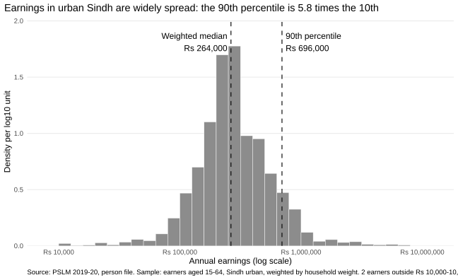
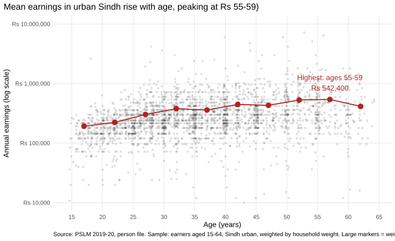
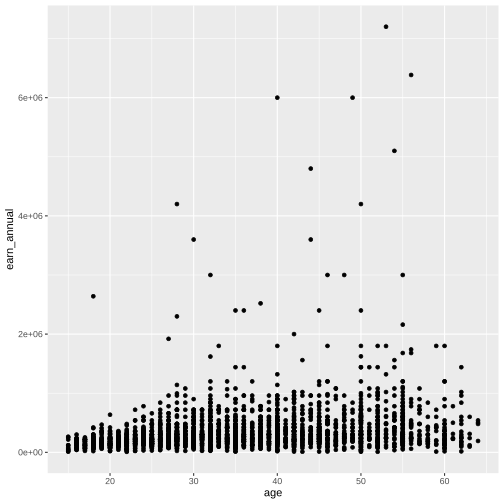
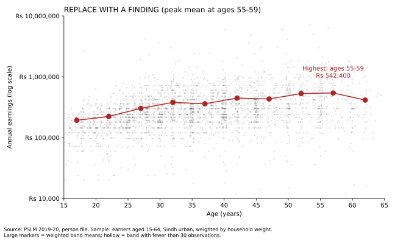

# ECO346 Assignment 1: Earnings in Urban Sindh (PSLM 2019-20)

**Name:** Maryam Mohsin  
**Registration number:** FA24-BEDS-043  
**Section:** A  
**Variant:** 3 (43 = 5 x 8 + 3), which is **Sindh urban** (`prov_code` = 3, `urban_rural` = 2)

**Sample:** persons aged 15-64 with annual earnings (`earn_annual`) above zero ("earners"), 2,644 in total. Every statistic is weighted by `hhweight`, attached from the household file by `hhid`.

## Figure 1: The distribution of annual earnings

| Statistic | Value |
|---|---|
| Number of earners | 2,644 |
| Weighted median | Rs 264,000 |
| Unweighted median | Rs 252,000 |
| Weighted 10th percentile | Rs 120,000 |
| Weighted 90th percentile | Rs 696,000 |
| Ratio p90/p10 | 5.80 |
| Earners excluded (outside Rs 10,000 to Rs 10,000,000) | 2 |

**What it shows:** Earnings of urban Sindh earners are widely spread: the weighted median is Rs 264,000, while the 90th percentile (Rs 696,000) is 5.80 times the 10th (Rs 120,000). The weighted median is slightly higher than the unweighted (Rs 252,000) because households represent different numbers of people, and weighting gives more influence to those representing more. The gap is small, about 5%.

## Figure 2: Earnings and age

### Band table

| Age band | Number of earners | Weighted mean earnings (Rs) |
|---|---|---|
| 15-19 | 160 | 192,523 |
| 20-24 | 296 | 222,948 |
| 25-29 | 398 | 303,154 |
| 30-34 | 396 | 379,254 |
| 35-39 | 359 | 360,221 |
| 40-44 | 344 | 446,533 |
| 45-49 | 250 | 431,697 |
| 50-54 | 212 | 530,773 |
| 55-59 | 157 | 542,400 |
| 60-64 | 72 | 414,262 |

No band has fewer than 30 observations, so no marker is hollow.

- Weighted mean, band 25-29: **Rs 303,154**
- Weighted mean, band 45-49: **Rs 431,697**
- Highest weighted mean: band **55-59** (Rs 542,400)

### Interpretation

Weighted mean earnings climb from Rs 192,523 at ages 15-19 to a peak of Rs 542,400 at 55-59, then fall to Rs 414,262 at 60-64, with small dips at 35-39 and 45-49. This fits human-capital theory: experience raises productivity, and the late fall may reflect retirement or selection. Earnings within each age are widely spread, so age explains only part of the variation. The figure cannot tell us whether a person's earnings rise with age: it is a single cross-section, so age and birth cohort are confounded.

## Redesign (default vs final)

The default figure is in `figures/default.svg` (R's untouched `geom_point()`), committed before the redesign.

## Second language: Python

The Python script recomputes the band table and redraws Figure 2 as `figures/scatter_python.svg`. Both band tables agree to the rupee (maximum difference 0). Band 25-29 weighted mean: R = Rs 303,154, Python = Rs 303,154.

## How to reproduce

Run from the repository folder, in this order. No internet is needed; the scripts read the local files in `data/`.

1. `scripts/00_helpers.R`: shared functions and data preparation (sourced by the others)
2. `scripts/01_default.R`: default figure (`figures/default.svg`)
3. `scripts/02_histogram.R`: Figure 1 (`figures/histogram.svg`)
4. `scripts/03_scatter.R`: Figure 2 and band table (`figures/scatter.svg`, `tables/band_table_R.csv`)
5. `scripts/04_python.py`: Python replication (`figures/scatter_python.svg`, `tables/band_table_python.csv`)

R packages: `tidyverse`, `svglite`, `scales`. Python packages: `pandas`, `numpy`, `matplotlib`.

## Data

`pslm_person_subset.csv` and `pslm_hh_subset.csv` from the course repository (PSLM 2019-20).
